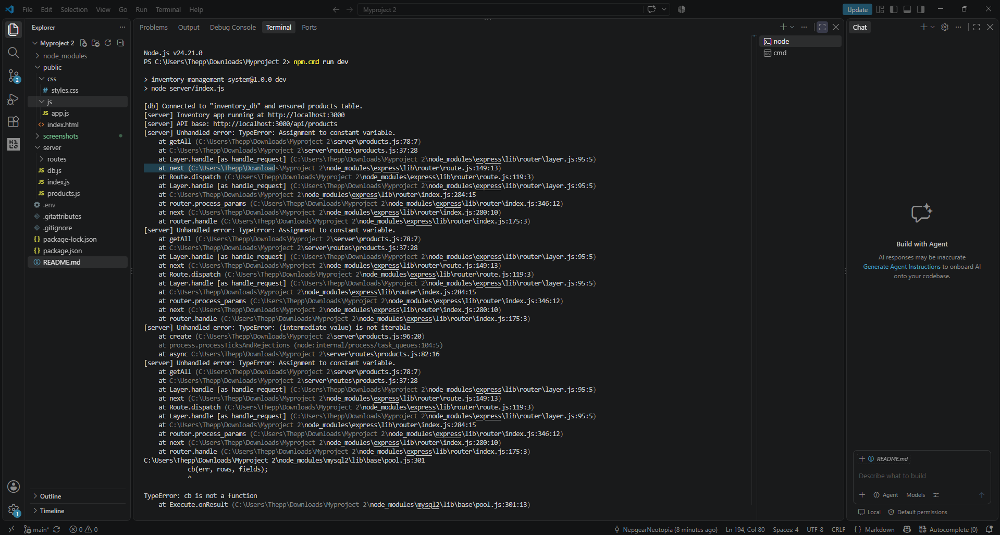
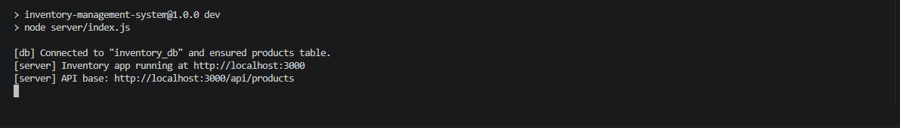
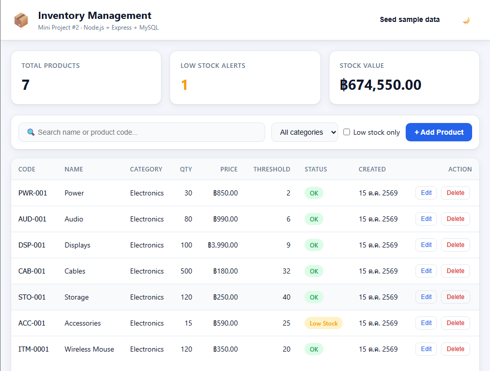

# Inventory Management System

Mini Project #2 — A web-based inventory management system built with Node.js, Express, and MySQL.

## สมาชิกกลุ่ม
| รหัสนักศึกษา | ชื่อ-นามสกุล | 
| 660910487 | นายชินกร เทพพงษ์ประดิษฐ | 
| 660910668 | นายบูรณ์ภัทร์ บุญสูขเกิด | 
| 660911043 | นายสิงหา ฝอยทับทิม |

## Screenshots
## Screenshots

### 1. Debugging Error
Error encountered during development before fixing the issue.



### 2. Debugging Fixed
Successful database connection and server startup after fixing the issue.



### 3. Inventory Management Website
The web application displaying the inventory management interface.



## Features

- View all products in an inventory table
- Add new products
- Edit existing product information
- Delete products
- Search products by name or product code
- Filter products by category
- Filter products with low stock
- Display total products, low-stock alerts, and total stock value
- Responsive user interface
- Light and dark theme support

## Tech Stack

- **Frontend:** HTML, CSS, JavaScript
- **Backend:** Node.js, Express.js
- **Database:** MySQL / MariaDB
- **Database Driver:** mysql2
- **Environment Configuration:** dotenv

## Project Structure

```text
Myproject 2/
├── public/
│   ├── index.html
│   ├── css/
│   │   └── styles.css
│   └── js/
│       └── app.js
├── server/
│   ├── db.js
│   ├── index.js
│   ├── products.js
│   └── routes/
│       └── products.js
├── .env
├── .gitignore
├── package.json
├── package-lock.json
└── README.md
```

## Requirements

- Node.js and npm
- XAMPP with MySQL or MariaDB
- A web browser

## Installation and Setup

### 1. Start MySQL

Open the XAMPP Control Panel and start MySQL.

Apache is only needed if you want to access phpMyAdmin through XAMPP.

### 2. Configure environment variables

Create a `.env` file in the project root:

```env
DB_HOST=localhost
DB_PORT=3306
DB_USER=root
DB_PASSWORD=
DB_NAME=inventory_db
DB_CONNECTION_LIMIT=10

PORT=3000
NODE_ENV=development
```

Adjust the database username and password if your local MySQL configuration is different.

**Security:** Do not commit `.env` to GitHub.

### 3. Install dependencies

Open a terminal in the project directory and run:

```bash
npm install
```

On Windows PowerShell, if the `npm` command is blocked by the execution policy, try:

```powershell
npm.cmd install
```

### 4. Run the application

```bash
npm run dev
```

On Windows PowerShell, you can also use:

```powershell
npm.cmd run dev
```

The server should be available at:

- Web application: http://localhost:3000
- Product API: http://localhost:3000/api/products

The application initializes the configured database and creates the `products` table if it does not exist.

## API Endpoints

Base URL: `/api/products`

| Method | Endpoint | Description |
|---|---|---|
| GET | `/api/products` | Retrieve products |
| GET | `/api/products/stats` | Retrieve inventory statistics |
| GET | `/api/products/:id` | Retrieve one product |
| POST | `/api/products` | Create a product |
| PUT | `/api/products/:id` | Update a product |
| DELETE | `/api/products/:id` | Delete a product |

### Query Parameters

The product list endpoint supports filtering options such as:

- `search` — Search by product name or product code
- `category` — Filter by category
- `lowStockOnly` — Show products at or below their low-stock threshold

Example:

```text
GET /api/products?search=Mouse
GET /api/products?category=Electronics
GET /api/products?lowStockOnly=true
```

## Product Data

Each product includes:

- Product code
- Name
- Category
- Quantity
- Price
- Low-stock threshold
- Creation date

The stock value is calculated from product quantity multiplied by product price.

## Testing

The application was manually tested for the following functions:

- Loading and displaying products
- Adding a product
- Editing a product
- Deleting a product
- Searching products
- Filtering by category and low-stock status
- Updating inventory statistics

## Troubleshooting

### Cannot connect to localhost:3000

Make sure the Node.js server is running in the terminal. Restart it with:

```bash
npm.cmd run dev
```

### Database connection error

Check that MySQL is running in XAMPP and verify the settings in `.env`.

### Product API error

Check the terminal for server-side errors and verify that the database connection and product routes are configured correctly.

## Notes

- Keep `.env` private.
- Do not upload `node_modules` to GitHub.
- The application uses the database configured by `DB_NAME`.
- Existing databases should not be deleted as part of normal application setup.